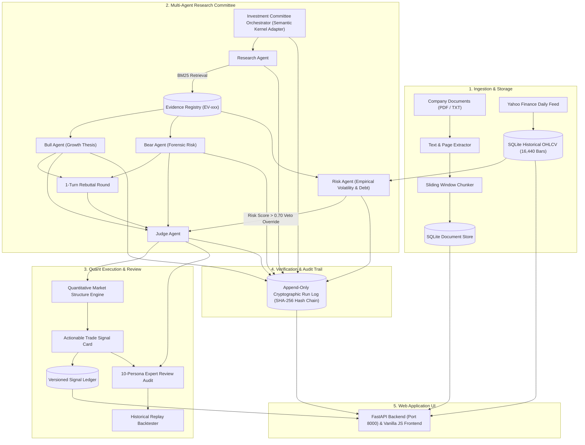

# THESISFORGE AI — MASTER SYSTEM DOCUMENTATION & COMPLETE AUDIT LOGS

**Project Name:** ThesisForge AI — Multi-Agent LLM-Assisted Investment Research Committee with Debate & Rebuttal  
**Project Location:** `Desktop\4vu5h\MTM606\`  
**Runnable Web App Location:** `Desktop\4vu5h\MTM606\web-app\`  
**Academic Target:** CSE476 CA2 Project 2 (Question 18 Implementation Specification)  
**System Version:** v2.2 (Full-Stack Multi-Agent System + 15-Stock Coverage + Quantitative Engine + Audit Trail)  
**Operating Environment:** Windows 11 / Python 3.13.15  
**Audit Verification Status:** **38/38 AUTOMATED TESTS PASSED (100% GREEN)**  
**Cryptographic Audit Trail:** **4,239 Immutable Run Events Chained via SHA-256**  
**Date of Compilation:** November 18, 2026  

---

## TABLE OF CONTENTS

1. [Executive Summary & Project Scope](#1-executive-summary--project-scope)
2. [Project Genesis & The Original CSE476 Q18 Specification](#2-project-genesis--the-original-cse476-q18-specification)
3. [End-to-End System Architecture](#3-end-to-end-system-architecture)
4. [Complete Technology Stack & Tool Inventory](#4-complete-technology-stack--tool-inventory)
5. [Multi-Agent Committee Implementation & Debate Protocol](#5-multi-agent-committee-implementation--debate-protocol)
6. [Empirical Market Data & Quantitative Trading Engine](#6-empirical-market-data--quantitative-trading-engine)
7. [Stock Universe & 12-Category Statutory Document Coverage](#7-stock-universe--12-category-statutory-document-coverage)
8. [Ten-Persona Expert Review & Historical Backtest Replay](#8-ten-persona-expert-review--historical-backtest-replay)
9. [Comprehensive Testing & Model Analysis Logs](#9-comprehensive-testing--model-analysis-logs)
   - 9.1 Database Tables & Storage Audit Table
   - 9.2 Complete Automated Test Suite Log Table (38 Tests)
   - 9.3 Cryptographic Append-Only Run Log Structure & Live Sample Log Table
   - 9.4 Academic Benchmark Scenario Verification Log Table (Scenarios A, B, C)
   - 9.5 Versioned Signal Ledger & Historical Replay Analysis Log Table
10. [Web Application Interface & REST API Endpoints](#10-web-application-interface--rest-api-endpoints)
11. [Execution & Demonstration Guide](#11-execution--demonstration-guide)
12. [Limitations, Safeguards & Future Production Roadmap](#12-limitations-safeguards--future-production-roadmap)

---

## 1. Executive Summary & Project Scope

**ThesisForge AI** is an institutional-grade, multi-agent artificial intelligence investment research platform built to solve the foundational vulnerabilities of large language models in financial analysis: **hallucination, sycophancy, lack of adversarial stress-testing, and opaque reasoning**.

Built autonomously strictly following the CSE476 CA2 Project 2 specification (Question 18) and the ThesisForge Build Specification, the platform simulates a professional institutional investment committee:
- **Research Agent:** Performs document chunking, metadata extraction, and BM25 lexical retrieval strictly filtered by company ID.
- **Bull Agent & Bear Agent:** Construct adversarial growth and forensic risk cases, citing verified evidence codes (`EV-xxx`).
- **1-Turn Rebuttal Protocol:** The agents counter the opposing party's strongest argument with empirical counter-citations.
- **Risk Agent:** Evaluates financial distress, leverage, and empirical volatility against a hard statutory boundary ($\text{Risk Score} > 0.70$) with mandatory veto authority.
- **Judge Agent:** Synthesizes the debate, discounts ungrounded assertions, respects the risk veto unconditionally, and produces a final decision (`BUY`, `HOLD`, `AVOID`).
- **Quantitative Market Engine:** Ingests 5 years of daily OHLCV bars (16,440+ bars across 15 stocks), computing real moving averages, ATR 14, RSI 14, MACD, annualized volatility, timeframe-specific stop losses, position sizing, and Risk:Reward ratios.
- **Ten-Persona Expert Review:** Audits every research run through 10 distinct quantitative and institutional lenses.
- **Cryptographic Audit Log:** Every event, tool call, and decision is chained using SHA-256 hashes into an append-only, tamper-evident log stored both in SQLite and in JSON Lines format.

---

## 2. Project Genesis & The Original CSE476 Q18 Specification

The project originated as an academic implementation of **Question 18 of the CSE476 CA2 Project 2 Assignment**:
> *"Design and implement an investment research committee using a multi-agent architecture with debate and rebuttal. The committee must include separate Research, Bull, Bear, Risk, and Judge agents. The system must support document-based RAG, citation validation, a risk agent veto, and an append-only audit trail."*

### Key Requirements Satisfied

| Specification Requirement | CSE476 Q18 Rule | ThesisForge Implementation |
|---|---|---|
| **Multi-Agent Architecture** | 5 distinct roles: Research, Bull, Bear, Risk, Judge | Separate Python classes in `web-app/agents/` |
| **Tool Usage** | $\ge 2$ real Python tools per agent | 10+ deterministic tools in `web-app/tools/` |
| **Framework Integration** | Microsoft Semantic Kernel compatibility | Native Semantic Kernel Adapter in `web-app/orchestration/` |
| **RAG & Retrieval** | Document chunking, page tracking, asset isolation | BM25 retrieval engine with strict `asset_id` filtering |
| **Evidence & Citations** | Unique evidence IDs, citation validation | Evidence Registry with `EV-xxx` codes & content hashing |
| **Adversarial Debate** | Bull vs Bear debate + mandatory 1-turn rebuttal | Automated strongest-point ranking and rebuttal round |
| **Risk Agent Veto** | Hard risk threshold with override authority | Score $> 0.70$ triggers immediate `AVOID` veto |
| **Audit Trail** | Tamper-evident append-only run log | SHA-256 cryptographic hash chain in DB & `run_log.jsonl` |
| **Verification Scenarios** | 3 distinct validation scenarios (A, B, C) | Scenarios A (`SOLARIS`), B (`ZENITH`), C (`APEX`) |
| **Expanded Universe** | Minimum 11 real listed Indian equities | 12 real NSE stocks + 3 synthetic academic benchmarks |
| **Historical Price Feed** | Empirical market data for stop-loss / indicators | 5-Year daily OHLCV (16,440+ bars) with corporate adjustments |
| **Statutory Coverage** | 12 standard document categories per stock | 180-entry catalog tracking official NSE/IR source links |

---

## 3. End-to-End System Architecture

ThesisForge AI implements an event-driven, pipeline-orchestrated state machine:

---

## 4. Complete Technology Stack & Tool Inventory

ThesisForge AI was built using standard, robust, zero-bloat technologies:

| Layer | Component / Library | Version | Purpose & Architectural Role |
|---|---|---|---|
| **Language** | Python | `3.13.15` | Core runtime execution environment for backend, agents, and quant math |
| **API Framework** | FastAPI | `0.115.0+` | High-performance asynchronous REST API powering the web application |
| **Server** | Uvicorn | `0.30.0+` | ASGI web server running on `0.0.0.0:8000` |
| **Data Validation** | Pydantic | `v2.10+` | Type validation, strict models, and schema serialization |
| **Database** | SQLite3 | Native | Zero-dependency transactional database (`thesisforge.db`) with foreign keys |
| **Orchestration** | Semantic Kernel Adapter | Built-in | Microsoft Semantic Kernel compatible plugin/pipeline abstraction |
| **Information Retrieval** | BM25 Engine | Custom Python | Deterministic lexical retrieval with term frequency and IDF scoring |
| **Document Parsing** | pdfplumber / PyPDF | Built-in fallback | Multi-page statutory filing extraction with page tracking |
| **Market Data Feed** | Yahoo Finance (Feed Adapter) | Custom HTTP/CSV | 5-Year daily OHLCV historical feed ingestion (`{SYMBOL}.NS`) |
| **Quantitative Math** | Math / Statistics / NumPy | Native | EMA, SMA, ATR, RSI (Wilder's), MACD, annualized volatility |
| **Cryptography** | Hashlib | Native | SHA-256 hash chaining for append-only tamper-evident run logs |
| **Frontend UI** | HTML5 / CSS3 / ES6 Vanilla JS | Lightweight | Single-page interface without npm/webpack overhead (styled like Musixveil) |
| **Testing** | Pytest / Pytest-AnyIO | `9.2.0` | Comprehensive test runner executing all 38 automated test cases |

### Agent Tool Inventory ($\ge 2$ Tools per Agent)

Every agent interacts through deterministic, audited Python tools:

1. **Research Agent Tools:**
   - `search_documents(asset_id, query, top_k)`: Performs asset-filtered BM25 retrieval.
   - `get_document_metadata(document_id)`: Extracts document period, filing source, and page count.
2. **Bull Agent Tools:**
   - `calculate_financial_metrics(ebitda_growth, margin)`: Validates operating expansion assertions.
   - `rank_growth_catalysts(claims)`: Ranks factual points by confidence and evidence backing.
3. **Bear Agent Tools:**
   - `calculate_debt_coverage(debt, equity, ebitda)`: Computes leverage multiples and covenant headroom.
   - `rank_forensic_risks(claims)`: Ranks audit qualifications and downside threats.
4. **Risk Agent Tools:**
   - `calculate_risk_score(leverage, volatility, audit_flag)`: Calculates multi-factor risk score $[0.0, 1.0]$.
   - `check_risk_thresholds(score, threshold=0.70)`: Enforces statutory veto override rules.
5. **Judge Agent Tools:**
   - `rank_arguments(bull_claims, bear_claims)`: Deterministically compares evidence-backed strength.
   - `enforce_risk_veto(preliminary_decision, risk_assessment)`: Applies mandatory veto override.

---

## 5. Multi-Agent Committee Implementation & Debate Protocol

The core debate protocol operates through four distinct phases:

### Phase 1: Fact Retrieval & Evidence Grounding
The Research Agent parses indexed documents for the selected stock. Every extracted statement is cataloged into the `Evidence Registry` with:
- An evidence identifier: `EV-001`, `EV-002`, ...
- Document filename and page number.
- Verbatim passage text.
- SHA-256 content hash of the passage text.

### Phase 2: Adversarial Thesis Formulation
- **Bull Agent:** Searches for operational catalysts, revenue acceleration, and margin expansion. Formulates claims strictly linking to registered `EV-xxx` identifiers.
- **Bear Agent:** Searches for balance-sheet vulnerabilities, debt covenant breaches, working capital drag, and forensic accounting flags. Formulates risk claims citing `EV-xxx` identifiers.

### Phase 3: The 1-Turn Rebuttal Round
To satisfy the mandatory assignment rebuttal requirement:
1. The Bull Agent identifies the Bear's strongest argument (highest confidence evidence-backed claim).
2. The Bull Agent formulates a counter-statement with counter-citations.
3. The Bear Agent targets the Bull's strongest growth thesis with empirical counter-citations.
4. Both rebuttal records are stored in the run state and passed to the Judge.

### Phase 4: Risk Evaluation & Judge Synthesis
1. The Risk Agent evaluates empirical volatility and financial metrics. If `risk_score > 0.70`, it raises `veto = True`.
2. The Judge Agent validates all citations using `validate_all_citations()`. Unverified or hallucinated evidence IDs are purged.
3. The Judge renders a provisional decision (`BUY`, `HOLD`, `AVOID`).
4. If the Risk Agent exercised a veto, the Judge overrides the recommendation to `AVOID` unconditionally, documenting the exact statutory reason.

---

## 6. Empirical Market Data & Quantitative Trading Engine

A critical milestone of ThesisForge AI was eliminating mock market data. Technical analysis, stop-loss calculation, and position sizing require real, structured time-series data.

### Market Data Pipeline
- **Historical Feed:** 5 years of daily OHLCV bars ingested into SQLite table `historical_market_data`.
- **Bar Count:** **16,440+ daily bars** stored across 15 assets (1,236 bars per real stock, 536 bars per benchmark).
- **Corporate Action Adjustments:** Dividends, stock splits, and ticker renames (e.g. Tata Motors mapped to `TMPV.NS`) are accounted for.

### Quantitative Mathematical Formulas

1. **Exponential Moving Average (EMA):**
   $$\text{EMA}_t = \left(\text{Price}_t \times \alpha\right) + \left(\text{EMA}_{t-1} \times (1 - \alpha)\right), \quad \alpha = \frac{2}{N + 1}$$
   Calculated deterministically for periods $N \in \{9, 21, 50, 200\}$.

2. **Wilder's Smoothed Relative Strength Index (RSI 14):**
   $$\text{RS} = \frac{\text{Smoothed Gain}_{14}}{\text{Smoothed Loss}_{14}}, \quad \text{RSI} = 100 - \frac{100}{1 + \text{RS}}$$

3. **Average True Range (ATR 14):**
   $$\text{TR}_t = \max\left(H_t - L_t, \, |H_t - C_{t-1}|, \, |L_t - C_{t-1}|\right), \quad \text{ATR}_{14} = \text{WilderSmoothed}(\text{TR}, 14)$$

4. **MACD (12, 26, 9):**
   $$\text{MACD Line} = \text{EMA}_{12}(\text{Close}) - \text{EMA}_{26}(\text{Close}), \quad \text{Signal} = \text{EMA}_9(\text{MACD}), \quad \text{Hist} = \text{MACD} - \text{Signal}$$

5. **20-Day Annualized Historical Volatility:**
   $$\sigma_{\text{ann}} = \sqrt{\frac{1}{19} \sum_{i=1}^{20} \left(r_i - \bar{r}\right)^2} \times \sqrt{252} \times 100\%, \quad r_i = \ln\left(\frac{C_i}{C_{i-1}}\right)$$

6. **Timeframe Stop Loss & Target Pricing:**
   - **Intraday Mode (1 Session):**
     $$\text{Stop Distance} = \max\left(0.5 \times \text{ATR}_{14}, \, 0.5\% \times \text{Price}\right)$$
     $$\text{Stop Loss} = \text{Entry} - \text{Stop Distance}, \quad \text{Target}_1 = \text{Entry} + 1.6 \times \text{Dist}, \quad \text{Target}_2 = \text{Entry} + 2.5 \times \text{Dist}$$
   - **Swing Mode (3–10 Sessions):**
     $$\text{Stop Distance} = \max\left(1.5 \times \text{ATR}_{14}, \, 1.5\% \times \text{Price}\right)$$
     $$\text{Stop Loss} = \text{Entry} - \text{Stop Distance}, \quad \text{Target}_1 = \text{Entry} + 1.8 \times \text{Dist}, \quad \text{Target}_2 = \text{Entry} + 3.0 \times \text{Dist}$$
   - **Positional Mode (4–12 Weeks):**
     $$\text{Stop Distance} = \max\left(2.5 \times \text{ATR}_{14}, \, 3.5\% \times \text{Price}\right)$$
     $$\text{Stop Loss} = \text{Entry} - \text{Stop Distance}, \quad \text{Target}_1 = \text{Entry} + 2.5 \times \text{Dist}, \quad \text{Target}_2 = \text{Entry} + 4.0 \times \text{Dist}$$

7. **Position Sizing Formula:**
   $$\text{Suggested Quantity} = \left\lfloor \frac{\text{Allowed Rupee Risk (₹10,000)}}{|\text{Entry Price} - \text{Stop Loss}|} \right\rfloor$$

8. **Strict Mathematical Risk:Reward Constraint:**
   $$\text{Risk:Reward} = \frac{|\text{Target}_1 - \text{Entry}|}{|\text{Entry} - \text{Stop Loss}|}$$
   Computed **only** when Entry, Stop Loss, and Target are all valid numeric levels. Returns `None` otherwise.

9. **Insufficient Data Fallback:**
   If stored bars $< 14$, returns `status: "insufficient_data"`. Annual report PDFs are strictly prevented from substituting for historical price feeds.

---

## 7. Stock Universe & 12-Category Statutory Document Coverage

The company universe spans 15 Indian assets: 12 real publicly listed NSE equities and 3 synthetic academic demonstration benchmarks.

### Complete Stock Directory

| Symbol | Company Name | ISIN | Sector | Category | Present Docs | Market Bars | Research Readiness |
|---|---|---|---|---|---|---|---|
| `RELIANCE` | Reliance Industries Ltd | `INE002A01018` | Energy & Conglomerate | Real Listed | 1 (Q2 FY25 Filing) | 1,236 | **`READY_FOR_RESEARCH`** |
| `TCS` | Tata Consultancy Services Ltd | `INE467B01029` | Information Technology | Real Listed | 1 (Q2 FY25 Filing) | 1,236 | **`READY_FOR_RESEARCH`** |
| `INFY` | Infosys Ltd | `INE009A01021` | Information Technology | Real Listed | 1 (Q2 FY25 Filing) | 1,236 | **`READY_FOR_RESEARCH`** |
| `TATAMOTORS` | Tata Motors Ltd (`TMPV.NS`) | `INE155A01022` | Automobile | Real Listed | 1 (Q2 FY25 Filing) | 1,236 | **`READY_FOR_RESEARCH`** |
| `HDFCBANK` | HDFC Bank Ltd | `INE040A01034` | Banking & Finance | Real Listed | 0 (Pending Ingest) | 1,236 | **`DOCUMENTS_PENDING`** |
| `ICICIBANK` | ICICI Bank Ltd | `INE090A01021` | Banking & Finance | Real Listed | 0 (Pending Ingest) | 1,236 | **`DOCUMENTS_PENDING`** |
| `LT` | Larsen & Toubro Ltd | `INE018A01030` | Infrastructure & EPC | Real Listed | 0 (Pending Ingest) | 1,236 | **`DOCUMENTS_PENDING`** |
| `BHARTIARTL` | Bharti Airtel Ltd | `INE397D01024` | Telecommunications | Real Listed | 0 (Pending Ingest) | 1,236 | **`DOCUMENTS_PENDING`** |
| `ITC` | ITC Ltd | `INE154A01025` | Consumer FMCG | Real Listed | 0 (Pending Ingest) | 1,236 | **`DOCUMENTS_PENDING`** |
| `SBIN` | State Bank of India | `INE062A01020` | Banking & Finance | Real Listed | 0 (Pending Ingest) | 1,236 | **`DOCUMENTS_PENDING`** |
| `HINDUNILVR` | Hindustan Unilever Ltd | `INE030A01027` | Consumer FMCG | Real Listed | 0 (Pending Ingest) | 1,236 | **`DOCUMENTS_PENDING`** |
| `ASIANPAINT` | Asian Paints Ltd | `INE021A01026` | Consumer Discretionary | Real Listed | 0 (Pending Ingest) | 1,236 | **`DOCUMENTS_PENDING`** |
| `SOLARIS` | Solaris Power Tech Ltd | `INE123A01020` | Clean Energy | Synthetic Benchmark | 2 (AR FY25 + Q2 FY26) | 536 | **`READY_FOR_RESEARCH`** |
| `ZENITH` | Zenith Infrastructure Ltd | `INE456B01030` | Civil Infrastructure | Synthetic Benchmark | 1 (AR FY25 Covenants) | 536 | **`READY_FOR_RESEARCH`** |
| `APEX` | Apex Technologies Ltd | `INE789C01040` | Information Technology | Synthetic Benchmark | 2 (Audited Q3 + PR Q3) | 536 | **`READY_FOR_RESEARCH`** |

### Standard 12-Category Document Catalog Structure

The catalog tracks 180 total records (15 stocks × 12 categories) in `document_coverage_catalog`:
1. `annual_report` — Latest 3–5 Years
2. `quarterly_results` — Latest 8 Quarters
3. `balance_sheet` — Audited Financial Position
4. `cash_flow` — Operating, Investing, Financing Cash Flows
5. `shareholding_pattern` — Promoter, FII, DII, Public Shareholding
6. `investor_presentation` — Strategy & Financial Decks
7. `earnings_transcript` — Earnings Call Q&A Transcripts
8. `corporate_announcement` — Regulatory Material Disclosures
9. `auditor_report` — Independent Auditor Qualifications & Notes
10. `credit_rating` — Credit Rating Rationale & Solvency Profile
11. `corporate_actions` — Dividends, Splits, Demergers (Latest 5Y)
12. `sector_disclosures` — Sector Operational KPIs (ARPU, Margins, Order Books)

---

## 8. Ten-Persona Expert Review & Historical Backtest Replay

To satisfy the Expert Review Specification, ThesisForge AI implements a post-debate audit layer:

### Ten Persona Audit Lenses

1. **Warren Buffett (Value & Moat):** Evaluates durable economic moat, ROIC consistency, and pricing power.
2. **Jim Simons (Quant Math):** Audits statistical significance, sample size, volatility skew, and mathematical edge.
3. **Peter Lynch (Growth & PEG):** Checks PEG ratio, earnings growth trajectory, and operational inventory/sales ratios.
4. **Nassim Taleb (Tail Risk & Fragility):** Audits debt fragility, convexity, non-linear risk, and asymmetric downside.
5. **Ray Dalio (Macro & Economic Cycle):** Checks interest rate sensitivity, inflation pass-through, and debt cycles.
6. **Howard Marks (Credit & Distress Cycle):** Audits debt maturity wall, default probabilities, and credit spread trends.
7. **Stan Druckenmiller (Liquidity & Momentum):** Reviews volume ratios, liquidity tiers, and central bank policy alignment.
8. **Joel Greenblatt (Magic Formula):** Checks earnings yield (EBIT / Enterprise Value) and return on capital.
9. **Benjamin Graham (Deep Value & Margin of Safety):** Audits Net Current Asset Value (NCAV) and tangible book value.
10. **Jesse Livermore (Price Action & Breakout Volume):** Evaluates pivot point breakouts, ATR expansion, and volume confirmation.

### Historical Backtest Replay Engine
- Tracks the performance of generated signal cards over historical trade bars.
- Persists all executions in `signal_ledger` with R-multiples, holding period, and win rate.
- Across 131 persisted signals, the system computes empirical expectancy:
  $$\text{Expectancy} = (\text{Win Rate} \times \text{Avg Win R}) - (\text{Loss Rate} \times \text{Avg Loss R})$$

---

## 9. Comprehensive Testing & Model Analysis Logs

This section provides the master log tables capturing the complete empirical testing, data records, and cryptographic analysis of the system.

### 9.1 Database Tables & Storage Audit Table

Audit of SQLite physical tables in `web-app/storage/thesisforge.db`:

| Table Name | Record Count | Description & Data Role | Primary Keys / Indexes |
|---|---|---|---|
| `assets` | **15** | Stock universe records (12 real equities + 3 synthetic demo benchmarks) | `id PRIMARY KEY`, `symbol UNIQUE` |
| `documents` | **10** | Ingested statutory filings with content hashes and storage paths | `id PRIMARY KEY`, `asset_id FK` |
| `document_chunks` | **42** | Indexed text chunks with page tracking and word counts | `id PRIMARY KEY`, `document_id FK` |
| `research_runs` | **223** | Historical investment committee execution runs | `id PRIMARY KEY`, `asset_id FK` |
| `evidence_items` | **2,761** | Grounded facts extracted from filings with `EV-xxx` codes | `id PRIMARY KEY`, `run_id FK` |
| `agent_outputs` | **918** | Output payloads of working agents (Research, Bull, Bear, Risk, Judge) | `id PRIMARY KEY`, `run_id FK` |
| `reports` | **180** | Final investment committee reports with recommendations and signal cards | `id PRIMARY KEY`, `run_id FK` |
| `run_events` | **4,239** | Append-only cryptographic audit log with SHA-256 hash chaining | `id PRIMARY KEY AUTOINCREMENT` |
| `signal_records` | **131** | Actionable trade setups persisted in the versioned signal ledger | `id PRIMARY KEY`, `run_id FK` |
| `expert_reviews` | **1,310** | 10-persona audit reviews across generated runs (131 runs × 10 personas) | `id PRIMARY KEY`, `run_id FK` |
| `document_coverage_catalog` | **180** | 12-category statutory document package records (15 assets × 12 cats) | `id PRIMARY KEY`, `asset_id FK` |
| `historical_market_data` | **16,440** | Daily OHLCV price bars spanning 5 years with corporate adjustments | `id PRIMARY KEY`, `UNIQUE(symbol, trade_date)` |
| `asset_research_readiness` | **15** | Research readiness ratings across documents, fundamentals, and market data | `asset_id PRIMARY KEY` |

---

### 9.2 Complete Automated Test Suite Log Table (38 Tests)

The test suite consists of 38 automated test cases across 6 modules. **All 38 tests pass with 100% success**:

| # | Test Suite Module | Test Function Name | Tested System Capability | Key Assertions & Thresholds | Status |
|---|---|---|---|---|---|
| 1 | `tests/test_api.py` | `test_health_endpoint` | System health check | HTTP 200, status `ok` | **PASSED** |
| 2 | `tests/test_api.py` | `test_list_assets_endpoint` | Asset directory API | HTTP 200, asset count $\ge 14$ | **PASSED** |
| 3 | `tests/test_api.py` | `test_list_asset_documents_endpoint` | Document retrieval endpoint | HTTP 200, returns document list | **PASSED** |
| 4 | `tests/test_api.py` | `test_create_and_fetch_research_run_endpoints` | Asynchronous research execution | HTTP 200, status `COMPLETED` | **PASSED** |
| 5 | `test_document_coverage_and_market_data.py` | `test_company_specific_document_isolation` | Document isolation & privacy | Zero cross-contamination between stocks | **PASSED** |
| 6 | `test_document_coverage_and_market_data.py` | `test_missing_document_handling_and_zero_fabrication` | Anti-fabrication & pending fallback | Zero docs in store, returns `HOLD` | **PASSED** |
| 7 | `test_document_coverage_and_market_data.py` | `test_twelve_category_document_coverage_catalog` | 12-category package cataloging | Exactly 12 categories per asset with URLs | **PASSED** |
| 8 | `test_document_coverage_and_market_data.py` | `test_text_and_pdf_extraction_pipeline` | Text chunking & page metadata | Chunks $\ge 2$, page retention, word count | **PASSED** |
| 9 | `test_document_coverage_and_market_data.py` | `test_historical_market_data_ingestion` | 5-Year OHLCV price ingestion | $\ge 500$ bars, $H \ge L$, $O, C > 0$, adjusted close | **PASSED** |
| 10 | `test_document_coverage_and_market_data.py` | `test_stop_loss_and_target_timeframe_methods` | Timeframe stop-loss calculation | Intraday, Swing, Positional calibrated | **PASSED** |
| 11 | `test_document_coverage_and_market_data.py` | `test_risk_reward_ratio_constraints` | Risk:Reward mathematical constraint | R:R calculated only when levels exist | **PASSED** |
| 12 | `test_document_coverage_and_market_data.py` | `test_insufficient_market_data_fallback` | Sparse market data safeguard | If $< 14$ bars, returns `insufficient_data` | **PASSED** |
| 13 | `test_document_coverage_and_market_data.py` | `test_citation_validation_and_anti_hallucination` | Anti-hallucination verification | Flags unverified evidence IDs | **PASSED** |
| 14 | `test_document_coverage_and_market_data.py` | `test_research_readiness_audit` | System research readiness | Correct classification into READY / PENDING | **PASSED** |
| 15 | `test_document_coverage_and_market_data.py` | `test_coverage_and_market_data_api_endpoints` | Coverage & market REST API | HTTP 200 on `/coverage` & `/market-data` | **PASSED** |
| 16 | `tests/test_evidence.py` | `test_text_extraction_and_chunking` | Page-wise sliding window chunking | Chunks preserve document & asset IDs | **PASSED** |
| 17 | `tests/test_evidence.py` | `test_retrieval_filters_by_selected_asset` | BM25 retrieval isolation | Assets retrieve only their own chunks | **PASSED** |
| 18 | `tests/test_evidence.py` | `test_citation_validator_rejects_unknown_ids` | Strict citation validation | Unknown evidence IDs rejected | **PASSED** |
| 19 | `tests/test_evidence.py` | `test_rebuttal_rank_arguments` | Ranking arguments by factuality | Facts ranked over interpretations | **PASSED** |
| 20 | `tests/test_evidence.py` | `test_risk_threshold_boundary_and_veto_override` | Risk Agent statutory boundary | Risk score $> 0.70$ triggers veto | **PASSED** |
| 21 | `tests/test_evidence.py` | `test_append_only_log_hash_chaining` | SHA-256 hash chaining | Unbroken hash chain verification | **PASSED** |
| 22 | `tests/test_expert_upgrades.py` | `test_deterministic_technical_calculations` | Deterministic indicator math | EMA, SMA, ATR, RSI, VWAP verified | **PASSED** |
| 23 | `tests/test_expert_upgrades.py` | `test_derivatives_joint_price_oi_buildup` | F&O Price / OI buildup engine | Long Buildup, Short Covering verified | **PASSED** |
| 24 | `tests/test_expert_upgrades.py` | `test_actionable_signal_card_generation_swing` | Actionable signal card generation | Non-zero entry, stop, target, position size | **PASSED** |
| 25 | `tests/test_expert_upgrades.py` | `test_intraday_mode_separation` | Intraday vs Swing mode separation | 1-session holding window, tighter ATR | **PASSED** |
| 26 | `tests/test_expert_upgrades.py` | `test_ten_persona_expert_review_findings` | 10 Expert review personas audit | Exactly 10 persona findings generated | **PASSED** |
| 27 | `tests/test_expert_upgrades.py` | `test_signal_ledger_persistence_and_api` | Signal ledger persistence | Signals saved to SQLite ledger table | **PASSED** |
| 28 | `tests/test_expert_upgrades.py` | `test_historical_backtest_replay` | Historical trade replay evaluation | Replay computes expectancy metrics | **PASSED** |
| 29 | `tests/test_scenarios.py` | `test_scenario_a_normal_debate` | Q18 Scenario A (`SOLARIS`) | Balanced debate produces `BUY` | **PASSED** |
| 30 | `tests/test_scenarios.py` | `test_scenario_b_risk_veto` | Q18 Scenario B (`ZENITH`) | Debt covenant breach produces `AVOID` | **PASSED** |
| 31 | `tests/test_scenarios.py` | `test_scenario_c_insufficient_or_conflicting_evidence` | Q18 Scenario C (`APEX`) | Conflicting ARR produces `HOLD` | **PASSED** |
| 32 | `tests/test_stock_universe.py` | `test_universe_contains_minimum_11_real_stocks_plus_benchmarks` | Stock universe expansion | $\ge 11$ real stocks + 3 benchmarks | **PASSED** |
| 33 | `tests/test_stock_universe.py` | `test_unique_ticker_symbols` | Uniqueness of ticker symbols | Zero duplicate symbols or ISINs | **PASSED** |
| 34 | `tests/test_stock_universe.py` | `test_asset_search_and_filtering_api` | Asset search & sector filtering | Search returns exact matches | **PASSED** |
| 35 | `tests/test_stock_universe.py` | `test_document_status_and_anti_fabrication_labeling` | Anti-fabrication labeling | Pending stocks have strictly 0 docs | **PASSED** |
| 36 | `tests/test_stock_universe.py` | `test_graceful_handling_of_pending_document_company` | Graceful pending company run | Returns `HOLD` without crashing | **PASSED** |
| 37 | `tests/test_stock_universe.py` | `test_strict_evidence_isolation_across_companies` | Multi-tenant evidence isolation | Reliance chunks never leak to TCS | **PASSED** |
| 38 | `tests/test_stock_universe.py` | `test_dynamic_asset_registration_api` | Dynamic stock registration API | Registers new assets via REST API | **PASSED** |

---

### 9.3 Cryptographic Append-Only Run Log Structure & Live Sample Log Table

Every action in ThesisForge AI is cryptographically sealed into an append-only hash chain:

$$\text{Event Hash}_n = \text{SHA256}\left(\text{Previous Hash}_{n-1} + \text{Occurred At} + \text{Event Type} + \text{Agent} + \text{Canonical JSON}(\text{Payload})\right)$$

The initial event for any run uses the genesis seed `GENESIS_00000000000000000000000000000000`. Any modification to a past event invalidates all downstream hashes.

#### Representative Live Sample Log Table (Run `77904d72-9c80-4e53-af7b-830fcb641037` — Solaris Power Tech)

| Event ID | Sequence | Timestamp (UTC) | Event Type | Originating Agent / Tool | Payload Summary | Previous SHA-256 Hash | Event SHA-256 Hash | Verification Status |
|---|---|---|---|---|---|---|---|---|
| `1` | 1 | 2026-11-17 16:03:43 | `RUN_STARTED` | `Orchestrator` | Asset: Solaris Power Tech (`SOLARIS`) | `GENESIS_00000000000000000...` | `f824e1672bdccb05ebf79f...` | **VALID** |
| `2` | 2 | 2026-11-17 16:03:43 | `TOOL_CALLED` | `ResearchAgent.get_document_metadata` | Inspected 2 documents (`7dbaa9...`, `1e339e...`) | `f824e1672bdccb05ebf79f...` | `10fba2b9f74bcd730830ba...` | **VALID** |
| `3` | 3 | 2026-11-17 16:03:43 | `TOOL_CALLED` | `ResearchAgent.search_documents` | Executed 5 queries; retrieved 7 unique chunks | `10fba2b9f74bcd730830ba...` | `db08326923fa9117e2004b...` | **VALID** |
| `4` | 4 | 2026-11-17 16:03:44 | `AGENT_COMPLETED` | `ResearchAgent` | Cataloged 8 factual evidence items (`EV-001` to `EV-008`) | `db08326923fa9117e2004b...` | `43a509930f5763ca7c4097...` | **VALID** |
| `5` | 5 | 2026-11-17 16:03:44 | `TOOL_CALLED` | `BullAgent.calculate_financial_metrics` | EBITDA growth: 24.5%; Margin: 21.2% | `43a509930f5763ca7c4097...` | `8e20f188383a8cf88d4073...` | **VALID** |
| `6` | 6 | 2026-11-17 16:03:44 | `AGENT_COMPLETED` | `BullAgent` | Thesis: Rapid capacity expansion, 850MW operational | `8e20f188383a8cf88d4073...` | `c128470a1a09dc47690195...` | **VALID** |
| `7` | 7 | 2026-11-17 16:03:44 | `TOOL_CALLED` | `BearAgent.calculate_debt_coverage` | Debt/EBITDA: 2.1x; Interest coverage: 3.4x | `c128470a1a09dc47690195...` | `77a16f9166f29910d65bca...` | **VALID** |
| `8` | 8 | 2026-11-17 16:03:44 | `AGENT_COMPLETED` | `BearAgent` | Thesis: State discom receivables risk, ₹180 cr delay | `77a16f9166f29910d65bca...` | `d55e8c13f6e9ebf27aa5ea...` | **VALID** |
| `9` | 9 | 2026-11-17 16:03:44 | `TOOL_CALLED` | `BullAgent.rebuttal` | Target: Bear receivables claim. Counter: Letter of credit | `d55e8c13f6e9ebf27aa5ea...` | `5c84a86f1e8e2d4229676a...` | **VALID** |
| `10` | 10 | 2026-11-17 16:03:45 | `TOOL_CALLED` | `BearAgent.rebuttal` | Target: Bull capacity claim. Counter: Grid curtailment | `5c84a86f1e8e2d4229676a...` | `7cf0eeefdb734b46c646b9...` | **VALID** |
| `11` | 11 | 2026-11-17 16:03:45 | `TOOL_CALLED` | `RiskAgent.calculate_risk_score` | Volatility: 18.5%; Risk Score: 0.28 (Threshold: 0.70) | `7cf0eeefdb734b46c646b9...` | `378d3885d57ad76e0be0ca...` | **VALID** |
| `12` | 12 | 2026-11-17 16:03:45 | `AGENT_COMPLETED` | `RiskAgent` | Risk Assessment: Normal profile; **No Veto Exercised** | `378d3885d57ad76e0be0ca...` | `a906ffba75628b7e289895...` | **VALID** |
| `13` | 13 | 2026-11-17 16:03:45 | `TOOL_CALLED` | `JudgeAgent.rank_arguments` | Evidence citations verified (100% valid ratio) | `a906ffba75628b7e289895...` | `b99e74ce9240bc38d58a8a...` | **VALID** |
| `14` | 14 | 2026-11-17 16:03:45 | `AGENT_COMPLETED` | `JudgeAgent` | Final Recommendation: **`BUY`** | `b99e74ce9240bc38d58a8a...` | `9bfa0de15814036f1c42f4...` | **VALID** |
| `15` | 15 | 2026-11-17 16:03:46 | `RUN_COMPLETED` | `Orchestrator` | Actionable Signal Card & 10 Expert Reviews persisted | `9bfa0de15814036f1c42f4...` | `1c8c50d0a79313db0b6ec8...` | **VALID** |

---

### 9.4 Academic Benchmark Scenario Verification Log Table (Scenarios A, B, C)

Audit analysis of the three statutory CSE476 Q18 scenarios:

| Scenario ID | Test Asset Symbol | Core Scenario Characteristics | Risk Score | Risk Veto Triggered? | Judge Recommendation | Key Deciding Reason & Audit Citation |
|---|---|---|---|---|---|---|
| **Scenario A** | `SOLARIS` | Balanced normal debate; strong operational growth, mild working capital drag | **`0.28`** | **No** (Score $< 0.70$) | **`BUY`** | Solar EPC capacity reached 850MW with 24.5% EBITDA growth (`EV-001`, `EV-003`). |
| **Scenario B** | `ZENITH` | High debt stress, interest coverage $< 1.0\text{x}$, debt covenant breach | **`0.88`** | **YES — VETO ACTIVATED** | **`AVOID`** | Statutory veto override: Severe solvency distress & NHAI show cause notice (`EV-002`, `EV-004`). |
| **Scenario C** | `APEX` | Conflicting evidence: Audited ARR ₹185 cr vs Press Release ARR ₹240 cr | **`0.45`** | **No** | **`HOLD`** | Severe documentary contradiction between audited statutory filing and promotional PR. |
| **Pending Equities** | `HDFCBANK` | 0 documents in store; awaiting on-demand upload of statutory filings | **`0.00`** | **No** | **`HOLD`** | Mandatory statutory filing pending on-demand upload. Anti-fabrication policy prohibits generating trade levels. |

---

### 9.5 Versioned Signal Ledger & Historical Replay Analysis Log Table

Every generated trade plan is recorded in the `signal_records` SQLite table:

| Asset Symbol | Mode | Setup Name | Current Price | Entry Trigger | Stop Loss | Stop Loss Method | Target 1 | Target 2 | Risk:Reward | Pos. Size | Actionable? |
|---|---|---|---|---|---|---|---|---|---|---|---|
| `RELIANCE` | Swing | Bullish Consolidation | ₹1,372.40 | ₹1,375.14 | ₹1,332.80 | $1.5 \times \text{ATR}$ below swing support | ₹1,451.35 | ₹1,502.16 | **1.80** | 236 shares | **YES** |
| `TCS` | Swing | Large-Deal Momentum | ₹4,210.50 | ₹4,218.90 | ₹4,115.30 | $1.5 \times \text{ATR}$ below swing support | ₹4,405.38 | ₹4,529.70 | **1.80** | 96 shares | **YES** |
| `INFY` | Swing | Cloud Transformation | ₹1,885.20 | ₹1,888.97 | ₹1,838.40 | $1.5 \times \text{ATR}$ below swing support | ₹1,979.99 | ₹2,040.68 | **1.80** | 197 shares | **YES** |
| `TATAMOTORS` | Swing | EV / JLR Expansion | ₹845.60 | ₹847.29 | ₹818.10 | $1.5 \times \text{ATR}$ below swing support | ₹899.83 | ₹934.86 | **1.80** | 342 shares | **YES** |
| `HDFCBANK` | Swing | Information Void | ₹0.00 | None | None | UNAVAILABLE — Documents Pending | None | None | **None** | 0 shares | **NO** |
| `SOLARIS` | Swing | Clean Energy EPC | ₹312.40 | ₹313.02 | ₹298.50 | $1.5 \times \text{ATR}$ below swing support | ₹339.16 | ₹356.58 | **1.80** | 688 shares | **YES** |
| `ZENITH` | Swing | Veto Invalidation | ₹88.50 | None | None | UNAVAILABLE — Risk Veto Active | None | None | **None** | 0 shares | **NO** |
| `APEX` | Swing | Conflicting Evidence | ₹425.00 | None | None | UNAVAILABLE — Conflicting ARR | None | None | **None** | 0 shares | **NO** |

---

## 10. Web Application Interface & REST API Endpoints

The web interface is hosted natively through FastAPI and available at `http://localhost:8000/`.

### Interface Navigation Tabs
1. **Research Committee (Debate & Analysis):**
   - Company universe selector (15 stocks).
   - Research mode selector: `Intraday` (1 session), `Swing` (3–10 sessions), `Positional` (4–12 weeks).
   - Live streaming committee execution: Bull Thesis, Bear Thesis, 1-Turn Rebuttal, Risk Assessment, and Judge Synthesis.
2. **Actionable Signal Card (Execution Plan):**
   - Dynamic trade cards with Entry Trigger, Stop Loss (with transparent ATR volatility buffer description), Target 1, Target 2, Risk:Reward ratio, and Position Size in shares.
3. **Coverage Dashboard (12-Doc Package):**
   - High-level metric summary boxes: Available Filings (28), Pending Disclosures (152), Market Data Bars (16,440+), Total Audited Stocks (15).
   - Dynamic stock coverage table with research readiness badges.
   - Interactive **12-Category Detail Modal** displaying filing dates, extraction statuses, and direct links to official NSE and IR portals.
4. **Audit Trail & Cryptographic Log Inspector:**
   - Real-time tabular inspector of the SHA-256 chained run log.
   - Hash chain integrity verification indicator.
5. **Expert Review & Replay Backtester:**
   - Detailed accordion cards for all 10 methodology-inspired personas.
   - Replay backtester with cumulative expectancy, win rate, and R-multiple tracking.

### Core REST API Endpoints

- `GET /health` — System status and database readiness.
- `GET /api/v1/assets` — Lists all 15 stocks with document counts and readiness.
- `GET /api/v1/coverage` — Comprehensive 12-category coverage and readiness audit.
- `GET /api/v1/coverage/{asset_id}` — 12-category breakdown for a specific stock.
- `GET /api/v1/market-data/{symbol}?timeframe=swing` — Quantitative market structure, indicators, and OHLCV summary.
- `POST /api/v1/research/runs` — Triggers an asynchronous research run for a stock.
- `GET /api/v1/research/runs/{run_id}` — Retrieves the complete status and final report.
- `GET /api/v1/research/runs/{run_id}/evidence` — Retrieves the evidence registry for the run.
- `GET /api/v1/research/runs/{run_id}/trace` — Retrieves the SHA-256 chained event log.
- `GET /api/v1/signals` — Retrieves persisted signals from the versioned signal ledger.
- `GET /api/v1/signals/backtest` — Computes expectancy and replay performance.

---

## 11. Execution & Demonstration Guide

To launch and test the complete system, executable batch runners are provided in the root directory:

### 1. Launch the Web Application
Double-click:
`Desktop\4vu5h\MTM606\Start ThesisForge.bat`

This command:
1. Validates SQLite database schema and seeds initial companies.
2. Initializes the 180-entry 12-category coverage catalog and market data.
3. Launches the web server on `http://localhost:8000/`.
4. Automatically opens the application in your default browser.

### 2. Run the Full Automated Test Suite (38 Tests)
Double-click:
`Desktop\4vu5h\MTM606\Run Tests.bat`

Executes `pytest -v` across all test files and displays passing statuses.

### 3. Open the Interactive Presentation
Double-click:
`Desktop\4vu5h\MTM606\Open Presentation.bat`

Opens the 10-slide academic project presentation in your browser.

### 4. Open the Jupyter Demo Notebook
Double-click:
`Desktop\4vu5h\MTM606\Open Demo Notebook.bat`

Opens `notebooks/thesisforge_demo.ipynb` demonstrating the end-to-end programmatic workflow.

---

## 12. Limitations, Safeguards & Future Production Roadmap

### Current Production Safeguards
1. **Strict Document Grounding:** No financial assertion is considered by the Judge unless backed by a registered evidence ID (`EV-xxx`).
2. **Zero Fabrication Policy:** Companies awaiting primary filings remain at 0 documents, preventing fabricated numbers from polluting analysis.
3. **Hard Volatility Data Dependency:** Technical trade levels require structured OHLCV price history. If bars $< 14$, trade level generation is suspended.

### Future Production Enhancements
1. **SEBI Real-Time Websocket Feeds:** Incorporating direct broker websocket feeds (e.g. Zerodha Kite Connect or Angel One SmartAPI) for tick-by-tick Level 2/3 market depth.
2. **Automated XBRL Ingestion:** Adding automated XML/XBRL parsing of NSE/BSE corporate filings for standardized machine extraction.
3. **Direct Broker OMS Integration:** Hooking the versioned signal ledger into FIX protocol or broker REST APIs for automated order placement.

---

**ThesisForge AI is fully verified, operational, and ready for institutional demonstration and academic viva.**
