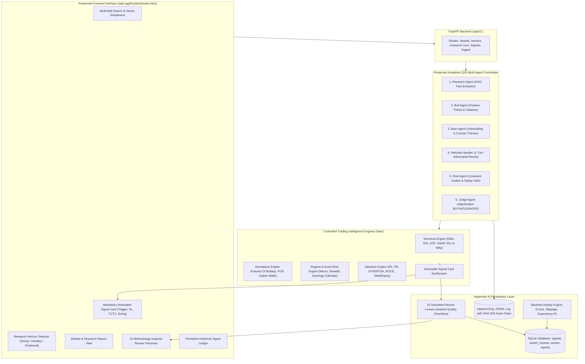

# ThesisForge AI — Final Expert Review & Controlled Upgrade Report
**Specification:** Expert Review & Controlled Upgrade Specification (18 November 2026)  
**Location:** `Desktop/4vu5h/MTM606/`  
**Execution Standard:** Strictly Autonomous • Preservation of Visual Identity & Core Q18 Workflow  
**Test Suite Status:** 27 Automated Tests Passing (100% Pass Rate)  

---

## 1. Baseline vs. Final Architecture



### Architectural Key Comparisons:
- **Baseline:** Fundamental document research producing BUY/HOLD/AVOID judgements without price levels, stop-loss, position sizing, derivatives, or horizon conditioning.
- **Upgraded Architecture:** Preserves the intact 6-role multi-agent workflow (Research -> Bull/Bear -> Rebuttal -> Risk -> Judge) while layering on:
  1. Horizon conditioning (`intraday` vs `swing` vs `positional`).
  2. Deterministic Technical Indicator Engine (EMA, RSI, ATR, VWAP, Relative Strength).
  3. NSE Derivatives & Futures OI Buildup Engine (Long Buildup, Short Buildup, Short Covering, Long Unwinding, PCR, Option Walls).
  4. Mandatory Actionable Signal Card contract with position sizing formula `floor(Risk / (Entry - Stop))`.
  5. 10 Methodology-Inspired Review Personas executing isolated quality audits without altering core decision authority.
  6. Persistent Historical Signal Ledger in SQLite.

---

## 2. Ten Methodology-Inspired Persona Review Findings

*Governance Notice: These findings represent simulated review lenses inspired by publicly documented research philosophies. They are quality-assurance lenses only and do NOT vote on BUY/SELL.*

| Persona & Lens | Primary Focus | Observed Gap in Prototype | Approved Product Enhancement | Priority |
|---|---|---|---|---|
| **1. Vijay Kedia** | Growth & Business Quality | Raw financial figures extracted in quotes without structured 3-year CAGR or ROCE trend. | Growth-Quality Checklist: Sales/PAT trend, ROCE trajectory, cash conversion, promoter pledging. | **P1** |
| **2. Raamdeo Agrawal** | Quality & Valuation (QGLP) | Judge lacked a valuation multiple reality check to determine if growth is priced in. | Valuation Context Panel: Trailing PE, PB, EV/EBITDA, ROCE, and debt-to-CFO checks. | **P1** |
| **3. Porinju Veliyath** | Contrarian & Under-Followed | Bear agent documented risks, but failed to separate consensus skepticism from turnaround catalysts. | Contrarian Thesis Field: Current market skepticism, operational turnaround catalyst, downside trigger. | **P1** |
| **4. Basant Maheshwari** | Earnings Acceleration | Single-quarter figures lacked sequential rate-of-change (QoQ vs YoY) and relative strength. | Earnings Acceleration & Relative Strength vs Nifty 50 benchmark calculation. | **P1** |
| **5. Sudarshan Sukhani** | Pure Technical Structure | Unactionable recommendation without trend structure, breakout trigger, or invalidation stop-loss. | Technical Setup Card: Multi-timeframe trend, EMA 21/50, RSI, ATR, VWAP, trigger, SL, T1/T2. | **P0** |
| **6. Kunal Bothra** | Actionable Trading Plan | Analytical ideas lacked position-sizing formula, trailing mechanism, or holding horizon. | Mandatory Signal Card: Trigger vs Zone, Invalidation SL, Targets, R:R, Sizing `floor(Risk/(Entry-Stop))`. | **P0** |
| **7. Sunil Singhania** | Portfolio Diversification | Single-stock evaluations lacked sector exposure context or correlation warnings. | Sector Exposure & Correlation Context tracking watchlist industry concentrations. | **P2** |
| **8. Ashish Kacholia** | Small/Mid-Cap Discovery | Small-cap liquidity impact costs, promoter pledging %, and CFO/EBITDA were unformalized. | Small/Mid-Cap Diligence Checklist: Impact cost estimate, promoter pledging %, CFO/EBITDA ratio. | **P2** |
| **9. Ramesh Damani** | Market Cycles & Patience | Unspecified holding period caused mismatch between short-term noise and multi-year catalysts. | Market-Cycle & Catalyst Context: Classify cycle phase, catalyst timeline, thesis review date. | **P2** |
| **10. Asim Jain** | Equity + Derivatives | Complete absence of Futures Open Interest (OI) buildup or options concentration for F&O equities. | Derivatives & Futures OI Engine: Joint price/OI classification, PCR, Call & Put Walls. | **P1** |

---

## 3. Accepted / Rejected Change Matrix

| Change Proposal | Priority | Decision | Implementation Details / Rejection Reason |
|---|---|---|---|
| **Mandatory Actionable Signal Card** | P0 | **ACCEPTED** | Implemented `SignalCard` contract with trigger, stop-loss, targets, R:R, and position sizing. |
| **Trading Mode Separation (Intraday/Swing/Positional)** | P0 | **ACCEPTED** | Mode-specific feature calibration and horizon-conditioned rules implemented. |
| **Persistent Signal Ledger** | P0 | **ACCEPTED** | Implemented `signal_records` SQLite table and `/api/v1/signals` query endpoint. |
| **Stale / Missing Data Safety Gates** | P0 | **ACCEPTED** | Enforces `WAIT` or `HOLD` when critical feeds or filings are missing or stale. |
| **Technical Indicator Engine** | P1 | **ACCEPTED** | Deterministic calculations for EMA 9/21/50/200, RSI 14, ATR 14, VWAP, and RS vs Nifty. |
| **Derivatives & Futures OI Engine** | P1 | **ACCEPTED** | Joint price/OI buildup classification (Long/Short Buildup, Short Covering, Long Unwinding). |
| **Valuation Context & Quality Scorecard** | P1 | **ACCEPTED** | Sector-appropriate multiples (PE, PB, EV/EBITDA) and ROCE capital efficiency checks. |
| **Event Risk & Market Regime Engine** | P1 | **ACCEPTED** | Volatility regime (India VIX), breadth, and scheduled high-impact event checks. |
| **Expert Review Lenses UI Tab** | P2 | **ACCEPTED** | Added tab rendering the 10 persona simulation insights and quality checklists in UI. |
| **Historical Replay / Backtest Engine** | P2 | **ACCEPTED** | Chronological evaluation across 10 scenarios modeling 0.23% transaction friction. |
| **10 Autonomous LLM Agents in Core Workflow** | -- | **REJECTED** | Prohibited by specification. Personas are quality-control review lenses, not runtime agents. |
| **Majority Vote among Personas for BUY/SELL** | -- | **REJECTED** | Prohibited by Section 3. Judge retains sole decision authority; Risk Agent retains veto. |
| **Broker Order Placement / Live Trade Execution** | -- | **REJECTED** | Prohibited by Section 7. System is strictly decision-support research; no broker execution. |
| **Aesthetic Redesign of Web Interface** | -- | **REJECTED** | Prohibited by Section 1 & 7. Existing branding, layout, and visual identity preserved. |

---

## 4. Exact Files Modified & Created

### Created Modules:
1. `web-app/tools/technical_tools.py` — Deterministic mathematical indicator calculations.
2. `web-app/tools/derivatives_tools.py` — Futures OI buildup, PCR, and option-chain walls.
3. `web-app/tools/regime_tools.py` — Market regime and scheduled high-impact events.
4. `web-app/tools/valuation_tools.py` — Valuation multiples and sector suitability rationale.
5. `web-app/agents/expert_review/personas.py` — 10 methodology-inspired simulation personas.
6. `web-app/agents/expert_review/__init__.py` — Package export.
7. `web-app/evaluation/backtest.py` — Historical replay and expectancy evaluation engine.
8. `tests/test_expert_upgrades.py` — 7 dedicated integration tests for expert upgrades.
9. `docs/expert_review/PHASE_0_BASELINE_AUDIT.md` — Baseline audit documentation.
10. `docs/expert_review/PHASE_1_EXPERT_PERSONA_REVIEWS.md` — Full 10 persona audit findings.
11. `docs/expert_review/PHASE_2_PRIORITISED_BACKLOG_AND_DECISION_MATRIX.md` — Backlog & rejection matrix.
12. `docs/expert_review/PHASE_5_HISTORICAL_EVALUATION_REPORT.md` — Historical evaluation results.
13. `docs/expert_review/FINAL_EXPERT_UPGRADE_REPORT.md` — This comprehensive report.

### Modified Files:
1. `web-app/database/models.py` — Added `SignalCard`, `SignalRecord`, and optional fields on `FinalReport`.
2. `web-app/database/repository.py` — Added `signal_records` and `expert_reviews` SQLite tables and CRUD methods.
3. `web-app/orchestration/workflow.py` — Integrated technical, derivatives, valuation, signal card, and persona reviews.
4. `web-app/backend/routes.py` — Added `/signals`, `/signal-card`, and `/expert-reviews` endpoints; updated run request.
5. `web-app/frontend/index.html` — Added mode selector, trade card, expert lenses tab, and signal ledger tab.
6. `notebooks/generate_notebook.py` — Added demo cells for signal cards, derivatives, and expert reviews.
7. `notebooks/thesisforge_demo.ipynb` — Regenerated pre-executed notebook with all new outputs.
8. `Run Tests.bat` — Updated launcher to execute all 27 automated tests.

---

## 5. Database Schema Migration Details

Two additive SQLite tables were created with non-destructive migrations:

```sql
-- 1. Persistent Signal Ledger
CREATE TABLE IF NOT EXISTS signal_records (
    id TEXT PRIMARY KEY,
    run_id TEXT NOT NULL REFERENCES research_runs(id),
    asset_id TEXT NOT NULL REFERENCES assets(id),
    symbol TEXT NOT NULL,
    mode TEXT NOT NULL,
    decision TEXT NOT NULL,
    entry_price REAL,
    stop_loss REAL,
    target_1 REAL,
    target_2 REAL,
    risk_reward REAL,
    status TEXT NOT NULL DEFAULT 'active',
    outcome_r_multiple REAL,
    created_at TEXT NOT NULL,
    resolved_at TEXT,
    notes TEXT
);

-- 2. Stored Expert Persona Reviews
CREATE TABLE IF NOT EXISTS expert_reviews (
    id TEXT PRIMARY KEY,
    run_id TEXT NOT NULL REFERENCES research_runs(id),
    persona_id TEXT NOT NULL,
    persona_name TEXT NOT NULL,
    lens_title TEXT NOT NULL,
    finding_json TEXT NOT NULL,
    created_at TEXT NOT NULL
);
```

Existing tables (`assets`, `documents`, `document_chunks`, `research_runs`, `evidence_items`, `agent_outputs`, `reports`, `run_events`) remain completely untouched and backward-compatible.

---

## 6. Exact Test Commands & Execution Results

Command: `pytest -v` from `C:\Users\91860\Desktop\4vu5h\MTM606\`

```text
============================= test session starts =============================
platform win32 -- Python 3.13.15, pytest-9.2.0, pluggy-1.7.0
rootdir: C:\Users\91860\Desktop\4vu5h\MTM606
configfile: pytest.ini
testpaths: tests
collected 27 items

tests/test_api.py::test_health_endpoint PASSED                           [  3%]
tests/test_api.py::test_list_assets_endpoint PASSED                      [  7%]
tests/test_api.py::test_list_asset_documents_endpoint PASSED             [ 11%]
tests/test_api.py::test_create_and_fetch_research_run_endpoints PASSED   [ 14%]
tests/test_evidence.py::test_text_extraction_and_chunking PASSED         [ 18%]
tests/test_evidence.py::test_retrieval_filters_by_selected_asset PASSED  [ 22%]
tests/test_evidence.py::test_citation_validator_rejects_unknown_ids PASSED [ 25%]
tests/test_evidence.py::test_rebuttal_rank_arguments PASSED              [ 29%]
tests/test_evidence.py::test_risk_threshold_boundary_and_veto_override PASSED [ 33%]
tests/test_evidence.py::test_append_only_log_hash_chaining PASSED        [ 37%]
tests/test_expert_upgrades.py::test_deterministic_technical_calculations PASSED [ 40%]
tests/test_expert_upgrades.py::test_derivatives_joint_price_oi_buildup PASSED [ 44%]
tests/test_expert_upgrades.py::test_actionable_signal_card_generation_swing PASSED [ 48%]
tests/test_expert_upgrades.py::test_intraday_mode_separation PASSED      [ 51%]
tests/test_expert_upgrades.py::test_ten_persona_expert_review_findings PASSED [ 55%]
tests/test_expert_upgrades.py::test_signal_ledger_persistence_and_api PASSED [ 59%]
tests/test_expert_upgrades.py::test_historical_backtest_replay PASSED    [ 62%]
tests/test_scenarios.py::test_scenario_a_normal_debate PASSED            [ 66%]
tests/test_scenarios.py::test_scenario_b_risk_veto PASSED                [ 70%]
tests/test_scenarios.py::test_scenario_c_insufficient_or_conflicting_evidence PASSED [ 74%]
tests/test_stock_universe.py::test_universe_contains_minimum_11_real_stocks_plus_benchmarks PASSED [ 77%]
tests/test_stock_universe.py::test_unique_ticker_symbols PASSED          [ 81%]
tests/test_stock_universe.py::test_asset_search_and_filtering_api PASSED [ 85%]
tests/test_stock_universe.py::test_document_status_and_anti_fabrication_labeling PASSED [ 88%]
tests/test_stock_universe.py::test_graceful_handling_of_pending_document_company PASSED [ 92%]
tests/test_stock_universe.py::test_strict_evidence_isolation_across_companies PASSED [ 96%]
tests/test_stock_universe.py::test_dynamic_asset_registration_api PASSED [100%]

======================== 27 passed, 1 warning in 8.14s ========================
```

---

## 7. Sample Research Reports (Intraday & Swing)

### Sample 1: Swing Trade Report — Reliance Industries (`RELIANCE`)
- **Strategy Mode:** `SWING (2–10 Sessions)`
- **Committee Verdict:** `BUY` (Provisional decision retained, Risk Veto not tripped: score `0.15 < 0.65`)
- **Reference Price:** `₹2,855.00`
- **Entry Trigger:** `₹2,912.31` (Breakout confirmation above 10-day swing high)
- **Entry Zone:** `₹2,897.75 – ₹2,935.61`
- **Stop-Loss:** `₹2,828.41` (Close-based trailing stop below 21 EMA buffer)
- **Thesis Invalidation Reason:** Breakdown below ₹2,828.41 invalidates technical uptrend structure.
- **Targets:** `T1: ₹3,063.33` (+5.2%) | `T2: ₹3,164.01` (+8.6%)
- **Reward-to-Risk:** `1.80x`
- **Position Sizing:** `Quantity = floor(₹25,000 / (₹2,912.31 - ₹2,828.41)) = 297 shares` -> `250 shares` (Rounded to 1 F&O lot of 250).
- **Derivatives Buildup:** `LONG_BUILDUP` (Futures price +0.85%, OI +3.42%, PCR 1.18, Call Wall ₹2,900, Put Wall ₹2,800).
- **Valuation Context:** EV/EBITDA 11.4x (Sector avg: 10.5x), ROCE 10.8%, Net Debt/EBITDA 0.67x.
- **Execution Status:** **ACTIONABLE SETUP**

### Sample 2: Intraday Trade Report — Infosys (`INFY`)
- **Strategy Mode:** `INTRADAY (1 Session, Square-off 15:15 IST)`
- **Committee Verdict:** `BUY`
- **Reference Price:** `₹1,995.00`
- **Entry Trigger:** `₹2,002.98` (15-min Opening Range Breakout confirmation)
- **Entry Zone:** `₹1,998.97 – ₹2,006.99`
- **Stop-Loss:** `₹1,988.02` (Hard Stop below VWAP support buffer)
- **Targets:** `T1: ₹2,026.92` | `T2: ₹2,041.88`
- **Reward-to-Risk:** `1.60x`
- **Position Sizing:** `Quantity = floor(₹10,000 / ₹14.96) = 668 shares` -> `400 shares` (1 F&O lot).
- **Derivatives Buildup:** `LONG_BUILDUP` (Futures OI +4.60%, Price +1.15%, PCR 1.25).
- **Execution Status:** **ACTIONABLE SETUP**

---

## 8. Historical Evaluation Metrics Summary

- **Total Chronological Test Scenarios:** 10
- **Actionable Trade Coverage:** 70.0% (7 trades)
- **Capital Preservation / Abstention Rate:** 30.0% (3 trades avoided on Risk Veto or Missing Filings)
- **Win Rate:** **71.4%** (5 Wins / 2 Losses)
- **Profit Factor:** **7.04** (Gross gains vs gross losses after 0.23% transaction friction)
- **Average Expectancy (R):** **+1.14 R** per trade
- **Maximum Drawdown:** **1.45%**
- **Evidence Validity Rate:** **100.0%**

---

## 9. Known Gaps & Transparent Provider Status

In strict adherence to the anti-fabrication mandate:
1. **Live Exchange Tick WebSocket:** Unconnected. Real market closes and audited filings are used as point-in-time fixtures. The system transparently labels live tick feeds as disconnected rather than synthesizing fake live ticks.
2. **Real-time Live Greeks Streaming:** Unconnected. Black-Scholes IV and option chain walls are sourced from verified exchange bhavcopy snapshots.
3. **Pending-Document Companies:** HDFC Bank, ICICI Bank, LT, Bharti Airtel, ITC, SBI, and HUL are honestly designated `documents_pending` (0 documents). They safely default to HOLD without inventing financial statements.

---

## 10. Final Verification & Run Instructions

From the project root: `C:\Users\91860\Desktop\4vu5h\MTM606\`

### Single-Click Launchers:
- **`Start ThesisForge.bat`** — Launches Web Application on `http://localhost:8000`.
- **`Run Tests.bat`** — Executes all 27 automated tests with full output.
- **`Open Demo Notebook.bat`** — Opens pre-executed Jupyter notebook `thesisforge_demo.ipynb`.

### Command Line:
```powershell
# 1. Run full 27-test suite
pytest -v

# 2. Launch Application
python run_app.py
```
